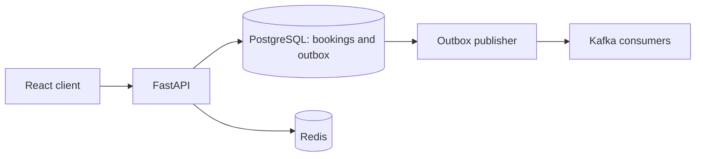

# Axiar

An asynchronous, multi-tenant field-service platform for booking, scheduling,
dispatch and payment workflows.

## Architecture

FastAPI and SQLAlchemy serve a React/TypeScript client. PostgreSQL/PostGIS stores
tenant-scoped business records; Redis supports caching and background work;
Kafka receives booking events through a transactional outbox. Docker Compose
provides a local development stack; Kubernetes examples are under `k8s/`.



## Local setup

Use Python 3.12, Node.js 22+, Docker Compose, and locally configured development
credentials. Copy `backend/.env.example` to your local `.env` and configure the
values for your own services.

```sh
docker compose up --build
docker compose exec backend alembic upgrade head
```

For separate development processes:

```sh
cd backend
python -m venv .venv
. .venv/bin/activate
pip install -r requirements.txt
uvicorn app.main:app --reload
```

In another terminal, run `npm ci && npm run dev` from `frontend/`.

## Verification

Backend tests require a disposable PostgreSQL/PostGIS database and Redis.
Configure test-only URLs before running `pytest` from `backend/`.
Frontend checks run from `frontend/`: `npm test`, `npm run lint`, `npm run build`.
The benchmark harness is under `benchmarks/`; load generation is an explicit
operation, separate from ordinary CI.

## Measured booking performance

| Experiment | Recorded result | Evidence |
| --- | --- | --- |
| Authenticated booking workflow, 10 minutes | 120,000 workflows; **999.94 HTTP requests/s**, **91 ms P95 / 127 ms P99**; zero observed HTTP errors or dropped arrivals | [Load measurements and reconciliation](benchmarks/reference_results.json) |
| Transactional event delivery | **360,000 expected and observed event IDs**; zero missing IDs, duplicate deliveries or tenant/payload mismatches in the featured run | [Broker audit counts](benchmarks/reference_results.json) |
| Availability repository optimization | **33.13 → 0.69 ms P50**, 97.92% lower, on 100,000 active bookings | [All 60 samples, SQL and query plans](benchmarks/availability_results.json) |

One workflow is five authenticated HTTP requests and three committed writes.
The load fixture used 100 tenants and 1,000 providers. All services and k6 ran on
one Ryzen 7 6800U host: eight cores/sixteen threads, approximately 13.3 GiB usable
RAM. The availability experiment used a separate two-tenant fixture. Its timing
includes repository and ORM work. The
change replaced full-row materialization and row locking with an indexed
interval-overlap existence query.

Check the saved evidence without generating load:

```sh
python benchmarks/verify_results.py
```

The verifier recomputes repository percentiles and checks aggregate workflow,
write and event accounting.
See [the benchmark protocol](benchmarks/README.md) for explicit load execution.

## Layout

`backend/` contains the API, migrations and tests; `frontend/` contains the web
client; `benchmarks/` contains reproducible workload tools and aggregate reference
results. `monitoring/`, `logging/` and `k8s/` contain optional infrastructure examples.

## Security and licensing

Configure integrations through environment variables. See `SECURITY.md`,
`CONTRIBUTING.md`, `NOTICE` and `LICENSE`.
